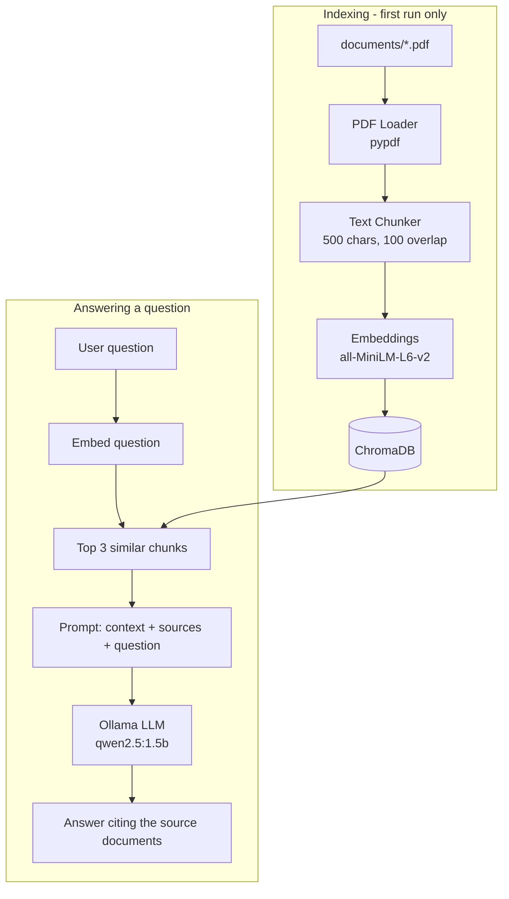

# Construction RAG Assistant

[](https://github.com/shorif-mahmud-abdullah/construction-rag-assistant/actions/workflows/ci.yml)

-black)

A Retrieval-Augmented Generation (RAG) system for construction engineering documentation. Ask questions about construction safety, materials, project management, and more - get answers grounded in your documents.

## Architecture



**Components:**
- **PDF Loader**: Extracts text from PDF documents using `pypdf`
- **Text Chunker**: Splits documents into overlapping chunks (500 chars, 100 overlap)
- **Embedding Model**: `all-MiniLM-L6-v2` via `sentence-transformers`
- **Vector Database**: ChromaDB for persistent vector storage
- **LLM**: Ollama (local inference, default: `qwen2.5:1.5b`)

## Prerequisites

1. **Python 3.10+**
2. **Ollama** installed and running ([ollama.ai](https://ollama.ai))

## Installation

```bash
# Clone the repository
git clone <repository-url>
cd construction-rag-assistant

# Create virtual environment
python -m venv .venv
.venv\Scripts\activate  # Windows
# source .venv/bin/activate  # Linux/Mac

# Install dependencies
pip install -r requirements.txt

# Pull the Ollama model
ollama pull qwen2.5:1.5b
```

## Configuration

Copy the example environment file and configure:

```bash
cp env.example .env
```

Edit `.env`:

```env
OLLAMA_MODEL=qwen2.5:1.5b
OLLAMA_HOST=http://localhost:11434
```

| Variable | Description | Default |
|----------|-------------|---------|
| `OLLAMA_MODEL` | Ollama model name | `qwen2.5:1.5b` |
| `OLLAMA_HOST` | Ollama server URL | `http://localhost:11434` |

## Usage

1. Place PDF documents in the `documents/` folder

2. Run the application:

```bash
python -m app.main
```

3. Ask questions interactively:

```
Question: What are the OSHA fall protection requirements?
Question: exit
```

On first run, documents are indexed automatically. Subsequent runs reuse the existing vector database.

## Project Structure

```
construction-rag-assistant/
├── app/
│   ├── main.py              # Entry point
│   ├── config.py             # Environment configuration
│   ├── loader/
│   │   └── pdf_loader.py     # PDF text extraction
│   ├── chunking/
│   │   └── text_chunker.py   # Text splitting with overlap
│   ├── embeddings/
│   │   └── embedding_model.py # SentenceTransformer wrapper
│   ├── vectordb/
│   │   └── chroma_store.py   # ChromaDB vector operations
│   ├── llm/
│   │   └── client.py         # Ollama API client
│   ├── rag/
│   │   └── rag_service.py    # RAG pipeline orchestration
│   └── prompts/              # Prompt templates
├── documents/                # PDF knowledge base
├── chroma_db/                # Vector database (auto-created)
├── requirements.txt
├── env.example
└── README.md
```

## Sample Documents

The `documents/` folder includes 5 construction engineering PDFs:

1. Construction Safety Regulations
2. Building Materials Specifications
3. Construction Project Management
4. Structural Engineering Principles
5. Green Building & Sustainable Construction

## How It Works

1. **Indexing** (first run only):
   - PDFs are loaded and text extracted
   - Text is split into 500-character chunks with 100-character overlap
   - Each chunk is embedded using `all-MiniLM-L6-v2`
   - Embeddings are stored in ChromaDB with source metadata

2. **Querying**:
   - User question is embedded using the same model
   - Top 3 similar chunks are retrieved from ChromaDB
   - Context is constructed with source citations
   - LLM generates answer using only the provided context

## Tests

```bash
pip install pypdf chromadb numpy requests python-dotenv pytest
python -m pytest -q
```

The suite covers chunking, PDF text extraction, the vector store, the RAG prompt and the Ollama client. The embedding model is stubbed, so tests run in about a second without downloading models or running Ollama. GitHub Actions runs them on every push.

## Troubleshooting

**Model download slow?** Set a Hugging Face token for faster downloads:
```bash
set HF_TOKEN=your_token  # Windows
export HF_TOKEN=your_token  # Linux/Mac
```

**Ollama connection error?** Ensure Ollama is running:
```bash
ollama serve
```

**Indexed before the chunk-id fix (October 2026)?** Earlier versions gave every document the same chunk ids, so later PDFs overwrote earlier ones and only part of the knowledge base was searchable. Delete `chroma_db/` once and re-run to index all documents correctly.

**Reset database?** Delete the `chroma_db/` folder to re-index documents:
```bash
rmdir /s /q chroma_db  # Windows
rm -rf chroma_db       # Linux/Mac
```
